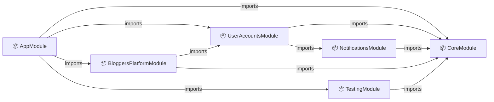
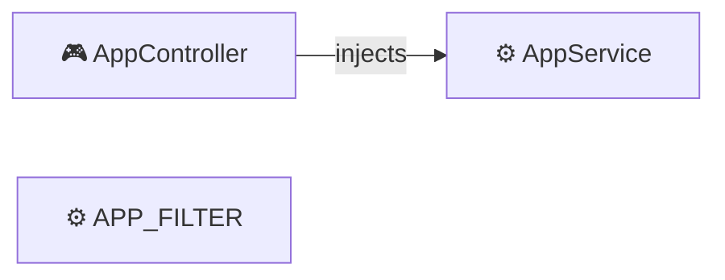
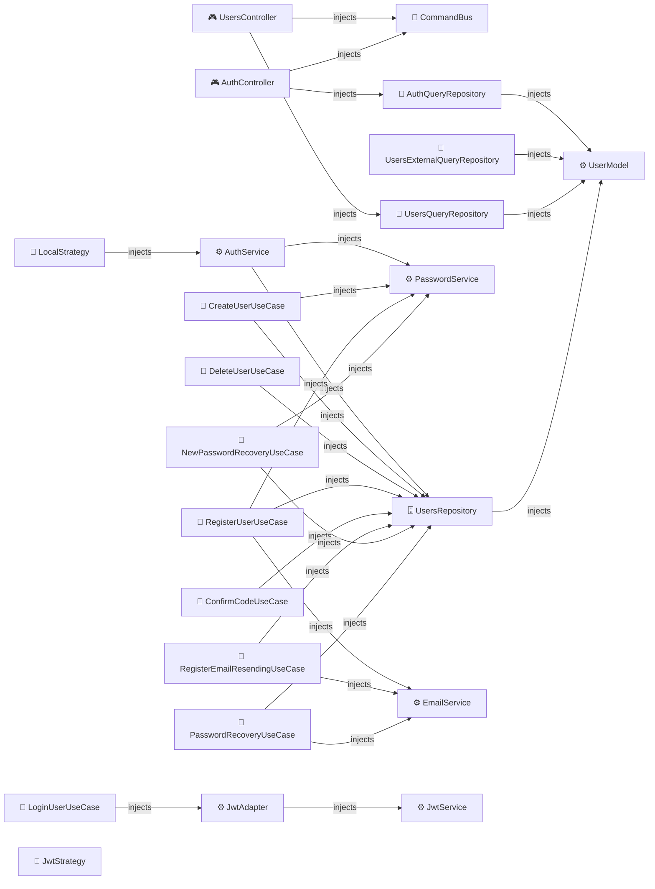
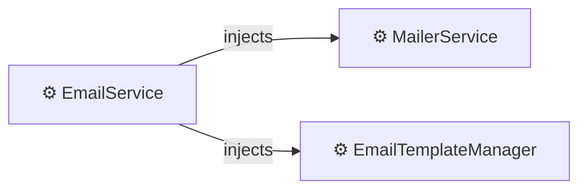
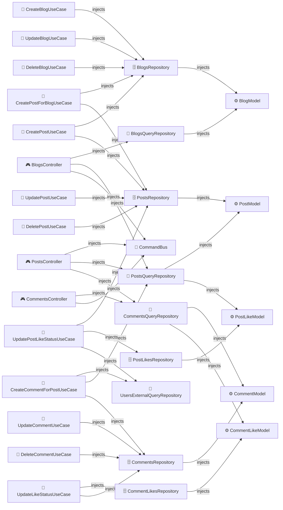
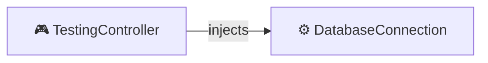

# NestJS architecture

## 1. Modules

## 2. Controllers and providers

```mermaid
graph LR
  AppModule["📦 AppModule"]
  AppModule_AppController["🎮 AppController"]
  AppModule --> AppModule_AppController
  AppModule_AppService["⚙️ AppService"]
  AppModule --> AppModule_AppService
  AppModule_APP_FILTER__UUID__e5a4ea97d0d1016e765f6_["⚙️ APP_FILTER (UUID: e5a4ea97d0d1016e765f6)"]
  AppModule --> AppModule_APP_FILTER__UUID__e5a4ea97d0d1016e765f6_
  AppModule_APP_FILTER__UUID__a4ea97d0d1016e765f6db_["⚙️ APP_FILTER (UUID: a4ea97d0d1016e765f6db)"]
  AppModule --> AppModule_APP_FILTER__UUID__a4ea97d0d1016e765f6db_
  UserAccountsModule["📦 UserAccountsModule"]
  UserAccountsModule_UsersController["🎮 UsersController"]
  UserAccountsModule --> UserAccountsModule_UsersController
  UserAccountsModule_AuthController["🎮 AuthController"]
  UserAccountsModule --> UserAccountsModule_AuthController
  UserAccountsModule_AuthService["⚙️ AuthService"]
  UserAccountsModule --> UserAccountsModule_AuthService
  UserAccountsModule_AuthQueryRepository["🔎 AuthQueryRepository"]
  UserAccountsModule --> UserAccountsModule_AuthQueryRepository
  UserAccountsModule_UsersExternalQueryRepository["🔎 UsersExternalQueryRepository"]
  UserAccountsModule --> UserAccountsModule_UsersExternalQueryRepository
  UserAccountsModule_UsersQueryRepository["🔎 UsersQueryRepository"]
  UserAccountsModule --> UserAccountsModule_UsersQueryRepository
  UserAccountsModule_UsersRepository["🗄️ UsersRepository"]
  UserAccountsModule --> UserAccountsModule_UsersRepository
  UserAccountsModule_PasswordService["⚙️ PasswordService"]
  UserAccountsModule --> UserAccountsModule_PasswordService
  UserAccountsModule_CreateUserUseCase["🧩 CreateUserUseCase"]
  UserAccountsModule --> UserAccountsModule_CreateUserUseCase
  UserAccountsModule_DeleteUserUseCase["🧩 DeleteUserUseCase"]
  UserAccountsModule --> UserAccountsModule_DeleteUserUseCase
  UserAccountsModule_LoginUserUseCase["🧩 LoginUserUseCase"]
  UserAccountsModule --> UserAccountsModule_LoginUserUseCase
  UserAccountsModule_RegisterUserUseCase["🧩 RegisterUserUseCase"]
  UserAccountsModule --> UserAccountsModule_RegisterUserUseCase
  UserAccountsModule_ConfirmCodeUseCase["🧩 ConfirmCodeUseCase"]
  UserAccountsModule --> UserAccountsModule_ConfirmCodeUseCase
  UserAccountsModule_RegisterEmailResendingUseCase["🧩 RegisterEmailResendingUseCase"]
  UserAccountsModule --> UserAccountsModule_RegisterEmailResendingUseCase
  UserAccountsModule_NewPasswordRecoveryUseCase["🧩 NewPasswordRecoveryUseCase"]
  UserAccountsModule --> UserAccountsModule_NewPasswordRecoveryUseCase
  UserAccountsModule_PasswordRecoveryUseCase["🧩 PasswordRecoveryUseCase"]
  UserAccountsModule --> UserAccountsModule_PasswordRecoveryUseCase
  UserAccountsModule_LocalStrategy["🔐 LocalStrategy"]
  UserAccountsModule --> UserAccountsModule_LocalStrategy
  UserAccountsModule_JwtStrategy["🔐 JwtStrategy"]
  UserAccountsModule --> UserAccountsModule_JwtStrategy
  UserAccountsModule_JwtAdapter["⚙️ JwtAdapter"]
  UserAccountsModule --> UserAccountsModule_JwtAdapter
  NotificationsModule["📦 NotificationsModule"]
  NotificationsModule_EmailService["⚙️ EmailService"]
  NotificationsModule --> NotificationsModule_EmailService
  NotificationsModule_EmailTemplateManager["⚙️ EmailTemplateManager"]
  NotificationsModule --> NotificationsModule_EmailTemplateManager
  BloggersPlatformModule["📦 BloggersPlatformModule"]
  BloggersPlatformModule_BlogsController["🎮 BlogsController"]
  BloggersPlatformModule --> BloggersPlatformModule_BlogsController
  BloggersPlatformModule_PostsController["🎮 PostsController"]
  BloggersPlatformModule --> BloggersPlatformModule_PostsController
  BloggersPlatformModule_CommentsController["🎮 CommentsController"]
  BloggersPlatformModule --> BloggersPlatformModule_CommentsController
  BloggersPlatformModule_BlogsRepository["🗄️ BlogsRepository"]
  BloggersPlatformModule --> BloggersPlatformModule_BlogsRepository
  BloggersPlatformModule_BlogsQueryRepository["🔎 BlogsQueryRepository"]
  BloggersPlatformModule --> BloggersPlatformModule_BlogsQueryRepository
  BloggersPlatformModule_PostsRepository["🗄️ PostsRepository"]
  BloggersPlatformModule --> BloggersPlatformModule_PostsRepository
  BloggersPlatformModule_PostsQueryRepository["🔎 PostsQueryRepository"]
  BloggersPlatformModule --> BloggersPlatformModule_PostsQueryRepository
  BloggersPlatformModule_PostLikesRepository["🗄️ PostLikesRepository"]
  BloggersPlatformModule --> BloggersPlatformModule_PostLikesRepository
  BloggersPlatformModule_CommentsQueryRepository["🔎 CommentsQueryRepository"]
  BloggersPlatformModule --> BloggersPlatformModule_CommentsQueryRepository
  BloggersPlatformModule_CommentsRepository["🗄️ CommentsRepository"]
  BloggersPlatformModule --> BloggersPlatformModule_CommentsRepository
  BloggersPlatformModule_CommentLikesRepository["🗄️ CommentLikesRepository"]
  BloggersPlatformModule --> BloggersPlatformModule_CommentLikesRepository
  BloggersPlatformModule_CreateBlogUseCase["🧩 CreateBlogUseCase"]
  BloggersPlatformModule --> BloggersPlatformModule_CreateBlogUseCase
  BloggersPlatformModule_UpdateBlogUseCase["🧩 UpdateBlogUseCase"]
  BloggersPlatformModule --> BloggersPlatformModule_UpdateBlogUseCase
  BloggersPlatformModule_DeleteBlogUseCase["🧩 DeleteBlogUseCase"]
  BloggersPlatformModule --> BloggersPlatformModule_DeleteBlogUseCase
  BloggersPlatformModule_CreatePostForBlogUseCase["🧩 CreatePostForBlogUseCase"]
  BloggersPlatformModule --> BloggersPlatformModule_CreatePostForBlogUseCase
  BloggersPlatformModule_CreatePostUseCase["🧩 CreatePostUseCase"]
  BloggersPlatformModule --> BloggersPlatformModule_CreatePostUseCase
  BloggersPlatformModule_UpdatePostUseCase["🧩 UpdatePostUseCase"]
  BloggersPlatformModule --> BloggersPlatformModule_UpdatePostUseCase
  BloggersPlatformModule_DeletePostUseCase["🧩 DeletePostUseCase"]
  BloggersPlatformModule --> BloggersPlatformModule_DeletePostUseCase
  BloggersPlatformModule_CreateCommentForPostUseCase["🧩 CreateCommentForPostUseCase"]
  BloggersPlatformModule --> BloggersPlatformModule_CreateCommentForPostUseCase
  BloggersPlatformModule_UpdateCommentUseCase["🧩 UpdateCommentUseCase"]
  BloggersPlatformModule --> BloggersPlatformModule_UpdateCommentUseCase
  BloggersPlatformModule_DeleteCommentUseCase["🧩 DeleteCommentUseCase"]
  BloggersPlatformModule --> BloggersPlatformModule_DeleteCommentUseCase
  BloggersPlatformModule_UpdateLikeStatusUseCase["🧩 UpdateLikeStatusUseCase"]
  BloggersPlatformModule --> BloggersPlatformModule_UpdateLikeStatusUseCase
  BloggersPlatformModule_UpdatePostLikeStatusUseCase["🧩 UpdatePostLikeStatusUseCase"]
  BloggersPlatformModule --> BloggersPlatformModule_UpdatePostLikeStatusUseCase
  TestingModule["📦 TestingModule"]
  TestingModule_TestingController["🎮 TestingController"]
  TestingModule --> TestingModule_TestingController
  CoreModule["📦 CoreModule"]
```

## 3. Dependency Injection

### AppModule

### UserAccountsModule

### NotificationsModule

### BloggersPlatformModule

### TestingModule

### UserAccountsModule

### NotificationsModule

### BloggersPlatformModule

### UserAccountsModule

### NotificationsModule

### NotificationsModule

## 4. CQRS

```mermaid
graph LR
  command_CreateUserCommand["📨 CreateUserCommand"]
  handler_CreateUserUseCase["🧩 CreateUserUseCase"]
  command_DeleteUserCommand["📨 DeleteUserCommand"]
  handler_DeleteUserUseCase["🧩 DeleteUserUseCase"]
  command_LoginUserCommand["📨 LoginUserCommand"]
  handler_LoginUserUseCase["🧩 LoginUserUseCase"]
  command_RegisterUserCommand["📨 RegisterUserCommand"]
  handler_RegisterUserUseCase["🧩 RegisterUserUseCase"]
  command_ConfirmCodeCommand["📨 ConfirmCodeCommand"]
  handler_ConfirmCodeUseCase["🧩 ConfirmCodeUseCase"]
  command_RegisterEmailResendingCommand["📨 RegisterEmailResendingCommand"]
  handler_RegisterEmailResendingUseCase["🧩 RegisterEmailResendingUseCase"]
  command_NewPasswordRecoveryCommand["📨 NewPasswordRecoveryCommand"]
  handler_NewPasswordRecoveryUseCase["🧩 NewPasswordRecoveryUseCase"]
  command_PasswordRecoveryCommand["📨 PasswordRecoveryCommand"]
  handler_PasswordRecoveryUseCase["🧩 PasswordRecoveryUseCase"]
  command_CreateBlogCommand["📨 CreateBlogCommand"]
  handler_CreateBlogUseCase["🧩 CreateBlogUseCase"]
  command_UpdateBlogCommand["📨 UpdateBlogCommand"]
  handler_UpdateBlogUseCase["🧩 UpdateBlogUseCase"]
  command_DeleteBlogCommand["📨 DeleteBlogCommand"]
  handler_DeleteBlogUseCase["🧩 DeleteBlogUseCase"]
  command_CreatePostForBlogCommand["📨 CreatePostForBlogCommand"]
  handler_CreatePostForBlogUseCase["🧩 CreatePostForBlogUseCase"]
  command_CreatePostCommand["📨 CreatePostCommand"]
  handler_CreatePostUseCase["🧩 CreatePostUseCase"]
  command_UpdatePostCommand["📨 UpdatePostCommand"]
  handler_UpdatePostUseCase["🧩 UpdatePostUseCase"]
  command_DeletePostCommand["📨 DeletePostCommand"]
  handler_DeletePostUseCase["🧩 DeletePostUseCase"]
  command_CreateCommentForPostCommand["📨 CreateCommentForPostCommand"]
  handler_CreateCommentForPostUseCase["🧩 CreateCommentForPostUseCase"]
  command_UpdateCommentCommand["📨 UpdateCommentCommand"]
  handler_UpdateCommentUseCase["🧩 UpdateCommentUseCase"]
  command_DeleteCommentCommand["📨 DeleteCommentCommand"]
  handler_DeleteCommentUseCase["🧩 DeleteCommentUseCase"]
  command_UpdateLikeStatusCommand["📨 UpdateLikeStatusCommand"]
  handler_UpdateLikeStatusUseCase["🧩 UpdateLikeStatusUseCase"]
  command_UpdatePostLikeStatusCommand["📨 UpdatePostLikeStatusCommand"]
  handler_UpdatePostLikeStatusUseCase["🧩 UpdatePostLikeStatusUseCase"]
  command_CreateUserCommand -->|handled by| handler_CreateUserUseCase
  command_DeleteUserCommand -->|handled by| handler_DeleteUserUseCase
  command_LoginUserCommand -->|handled by| handler_LoginUserUseCase
  command_RegisterUserCommand -->|handled by| handler_RegisterUserUseCase
  command_ConfirmCodeCommand -->|handled by| handler_ConfirmCodeUseCase
  command_RegisterEmailResendingCommand -->|handled by| handler_RegisterEmailResendingUseCase
  command_NewPasswordRecoveryCommand -->|handled by| handler_NewPasswordRecoveryUseCase
  command_PasswordRecoveryCommand -->|handled by| handler_PasswordRecoveryUseCase
  command_CreateBlogCommand -->|handled by| handler_CreateBlogUseCase
  command_UpdateBlogCommand -->|handled by| handler_UpdateBlogUseCase
  command_DeleteBlogCommand -->|handled by| handler_DeleteBlogUseCase
  command_CreatePostForBlogCommand -->|handled by| handler_CreatePostForBlogUseCase
  command_CreatePostCommand -->|handled by| handler_CreatePostUseCase
  command_UpdatePostCommand -->|handled by| handler_UpdatePostUseCase
  command_DeletePostCommand -->|handled by| handler_DeletePostUseCase
  command_CreateCommentForPostCommand -->|handled by| handler_CreateCommentForPostUseCase
  command_UpdateCommentCommand -->|handled by| handler_UpdateCommentUseCase
  command_DeleteCommentCommand -->|handled by| handler_DeleteCommentUseCase
  command_UpdateLikeStatusCommand -->|handled by| handler_UpdateLikeStatusUseCase
  command_UpdatePostLikeStatusCommand -->|handled by| handler_UpdatePostLikeStatusUseCase
  command_CreateUserCommand -->|handled by| handler_CreateUserUseCase
  command_DeleteUserCommand -->|handled by| handler_DeleteUserUseCase
  command_LoginUserCommand -->|handled by| handler_LoginUserUseCase
  command_RegisterUserCommand -->|handled by| handler_RegisterUserUseCase
  command_ConfirmCodeCommand -->|handled by| handler_ConfirmCodeUseCase
  command_RegisterEmailResendingCommand -->|handled by| handler_RegisterEmailResendingUseCase
  command_NewPasswordRecoveryCommand -->|handled by| handler_NewPasswordRecoveryUseCase
  command_PasswordRecoveryCommand -->|handled by| handler_PasswordRecoveryUseCase
  command_CreateBlogCommand -->|handled by| handler_CreateBlogUseCase
  command_UpdateBlogCommand -->|handled by| handler_UpdateBlogUseCase
  command_DeleteBlogCommand -->|handled by| handler_DeleteBlogUseCase
  command_CreatePostForBlogCommand -->|handled by| handler_CreatePostForBlogUseCase
  command_CreatePostCommand -->|handled by| handler_CreatePostUseCase
  command_UpdatePostCommand -->|handled by| handler_UpdatePostUseCase
  command_DeletePostCommand -->|handled by| handler_DeletePostUseCase
  command_CreateCommentForPostCommand -->|handled by| handler_CreateCommentForPostUseCase
  command_UpdateCommentCommand -->|handled by| handler_UpdateCommentUseCase
  command_DeleteCommentCommand -->|handled by| handler_DeleteCommentUseCase
  command_UpdateLikeStatusCommand -->|handled by| handler_UpdateLikeStatusUseCase
  command_UpdatePostLikeStatusCommand -->|handled by| handler_UpdatePostLikeStatusUseCase
  command_CreateUserCommand -->|handled by| handler_CreateUserUseCase
  command_DeleteUserCommand -->|handled by| handler_DeleteUserUseCase
  command_LoginUserCommand -->|handled by| handler_LoginUserUseCase
  command_RegisterUserCommand -->|handled by| handler_RegisterUserUseCase
  command_ConfirmCodeCommand -->|handled by| handler_ConfirmCodeUseCase
  command_RegisterEmailResendingCommand -->|handled by| handler_RegisterEmailResendingUseCase
  command_NewPasswordRecoveryCommand -->|handled by| handler_NewPasswordRecoveryUseCase
  command_PasswordRecoveryCommand -->|handled by| handler_PasswordRecoveryUseCase
```

