# NestJS architecture

## 1. Modules

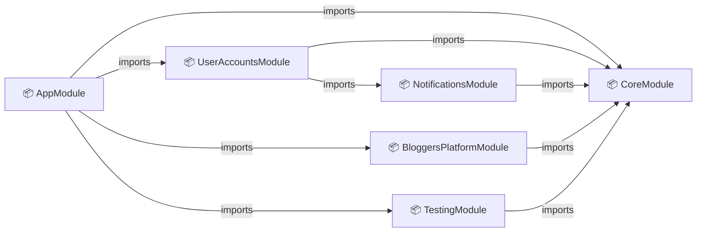

## 2. Controllers and providers

```mermaid
graph LR
  AppModule["📦 AppModule"]
  AppModule_AppController["🎮 AppController"]
  AppModule --> AppModule_AppController
  AppModule_AppService["⚙️ AppService"]
  AppModule --> AppModule_AppService
  AppModule_APP_FILTER__UUID__efa8daa6a6109934d02d0_["⚙️ APP_FILTER (UUID: efa8daa6a6109934d02d0)"]
  AppModule --> AppModule_APP_FILTER__UUID__efa8daa6a6109934d02d0_
  AppModule_APP_FILTER__UUID__a8daa6a6109934d02d097_["⚙️ APP_FILTER (UUID: a8daa6a6109934d02d097)"]
  AppModule --> AppModule_APP_FILTER__UUID__a8daa6a6109934d02d097_
  UserAccountsModule["📦 UserAccountsModule"]
  UserAccountsModule_UsersController["🎮 UsersController"]
  UserAccountsModule --> UserAccountsModule_UsersController
  UserAccountsModule_AuthController["🎮 AuthController"]
  UserAccountsModule --> UserAccountsModule_AuthController
  UserAccountsModule_AuthService["⚙️ AuthService"]
  UserAccountsModule --> UserAccountsModule_AuthService
  UserAccountsModule_AuthQueryRepository["🔎 AuthQueryRepository"]
  UserAccountsModule --> UserAccountsModule_AuthQueryRepository
  UserAccountsModule_UsersQueryRepository["🔎 UsersQueryRepository"]
  UserAccountsModule --> UserAccountsModule_UsersQueryRepository
  UserAccountsModule_UsersRepository["🗄️ UsersRepository"]
  UserAccountsModule --> UserAccountsModule_UsersRepository
  UserAccountsModule_UsersService["⚙️ UsersService"]
  UserAccountsModule --> UserAccountsModule_UsersService
  UserAccountsModule_BcryptService["⚙️ BcryptService"]
  UserAccountsModule --> UserAccountsModule_BcryptService
  UserAccountsModule_LocalStrategy["🔐 LocalStrategy"]
  UserAccountsModule --> UserAccountsModule_LocalStrategy
  UserAccountsModule_JwtStrategy["🔐 JwtStrategy"]
  UserAccountsModule --> UserAccountsModule_JwtStrategy
  NotificationsModule["📦 NotificationsModule"]
  NotificationsModule_EmailService["⚙️ EmailService"]
  NotificationsModule --> NotificationsModule_EmailService
  NotificationsModule_EmailTemplateManager["⚙️ EmailTemplateManager"]
  NotificationsModule --> NotificationsModule_EmailTemplateManager
  BloggersPlatformModule["📦 BloggersPlatformModule"]
  BloggersPlatformModule_BlogsController["🎮 BlogsController"]
  BloggersPlatformModule --> BloggersPlatformModule_BlogsController
  BloggersPlatformModule_PostsController["🎮 PostsController"]
  BloggersPlatformModule --> BloggersPlatformModule_PostsController
  BloggersPlatformModule_CommentsController["🎮 CommentsController"]
  BloggersPlatformModule --> BloggersPlatformModule_CommentsController
  BloggersPlatformModule_BlogsService["⚙️ BlogsService"]
  BloggersPlatformModule --> BloggersPlatformModule_BlogsService
  BloggersPlatformModule_BlogsRepository["🗄️ BlogsRepository"]
  BloggersPlatformModule --> BloggersPlatformModule_BlogsRepository
  BloggersPlatformModule_BlogsQueryRepository["🔎 BlogsQueryRepository"]
  BloggersPlatformModule --> BloggersPlatformModule_BlogsQueryRepository
  BloggersPlatformModule_PostsService["⚙️ PostsService"]
  BloggersPlatformModule --> BloggersPlatformModule_PostsService
  BloggersPlatformModule_PostsRepository["🗄️ PostsRepository"]
  BloggersPlatformModule --> BloggersPlatformModule_PostsRepository
  BloggersPlatformModule_PostsQueryRepository["🔎 PostsQueryRepository"]
  BloggersPlatformModule --> BloggersPlatformModule_PostsQueryRepository
  BloggersPlatformModule_CommentsQueryRepository["🔎 CommentsQueryRepository"]
  BloggersPlatformModule --> BloggersPlatformModule_CommentsQueryRepository
  TestingModule["📦 TestingModule"]
  TestingModule_TestingController["🎮 TestingController"]
  TestingModule --> TestingModule_TestingController
  CoreModule["📦 CoreModule"]
```

## 3. Dependency Injection

### AppModule

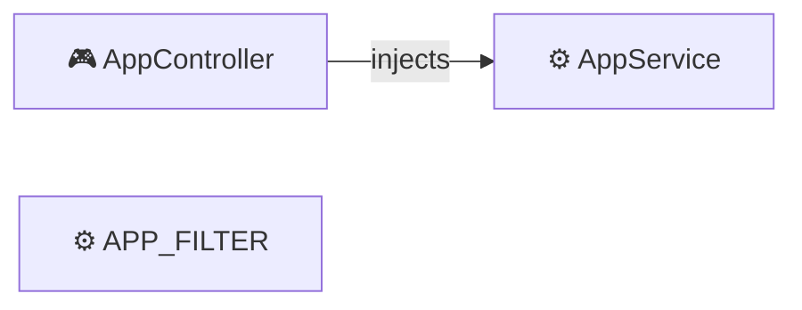

### ThrottlerModule

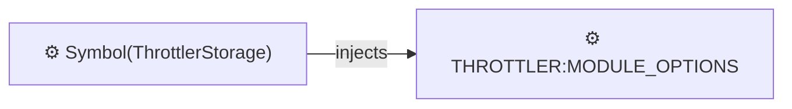

### ConfigModule

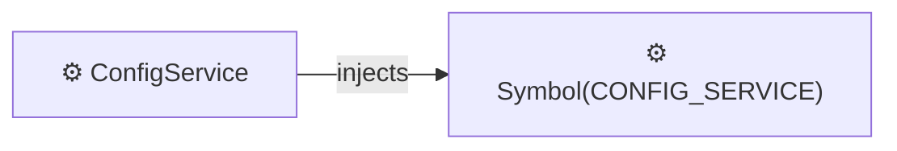

### UserAccountsModule

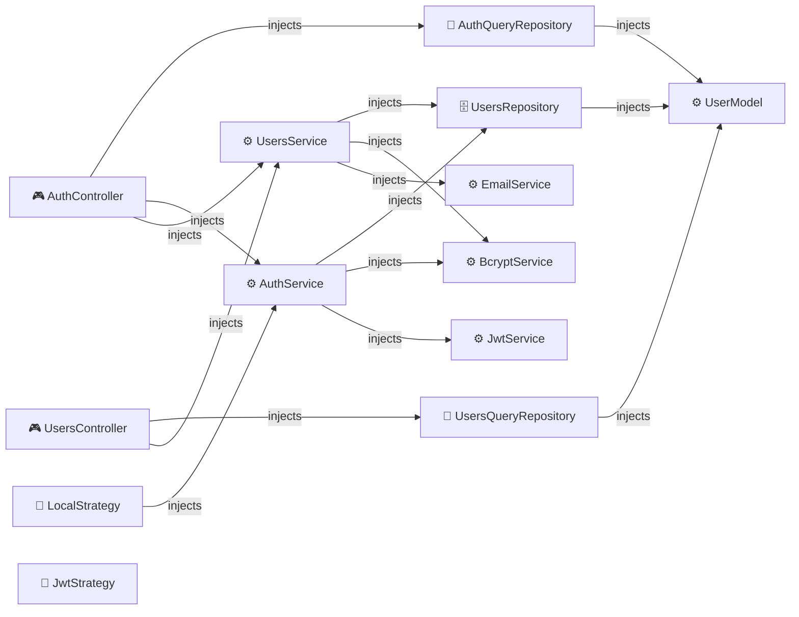

### MongooseModule

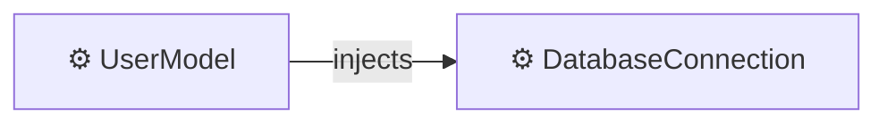

### NotificationsModule

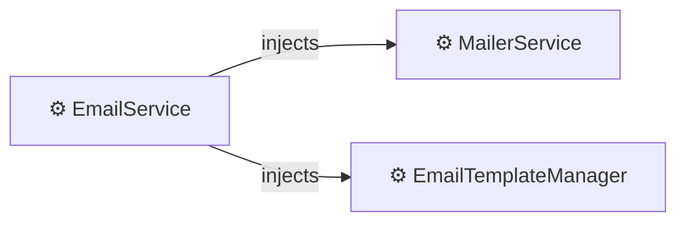

### MailerCoreModule

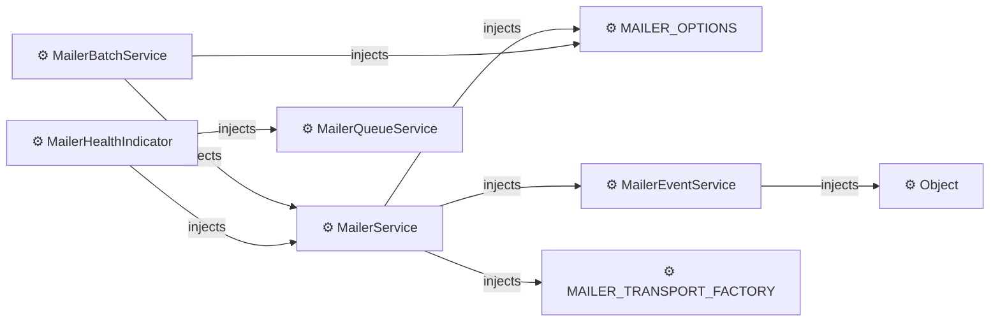

### BloggersPlatformModule

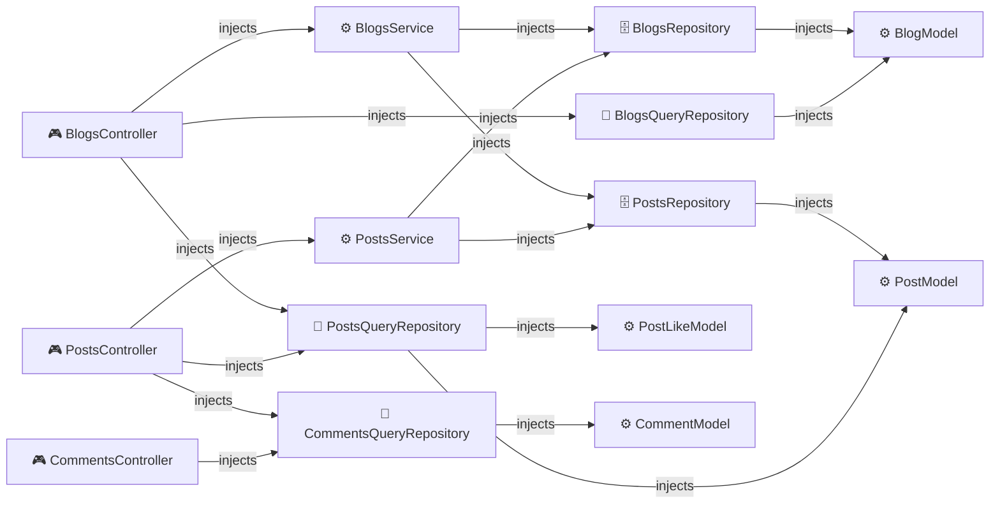

### MongooseModule

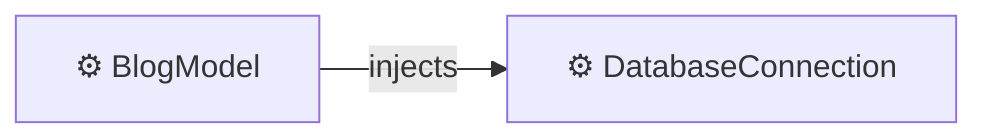

### MongooseModule

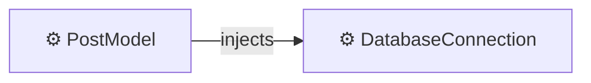

### MongooseModule

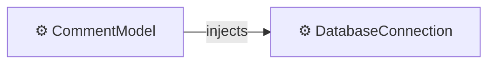

### MongooseModule

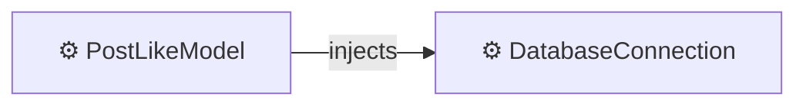

### TestingModule

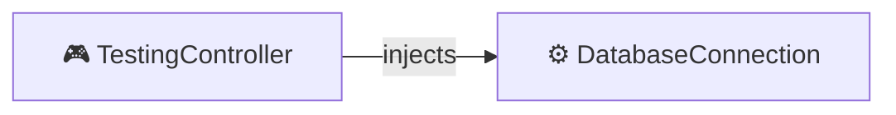

### UserAccountsModule


### MongooseModule


### NotificationsModule


### MailerCoreModule


### BloggersPlatformModule


### MongooseModule

```mermaid
graph LR
  BlogModel["⚙️ BlogModel"]
  DatabaseConnection["⚙️ DatabaseConnection"]
  BlogModel -->|injects| DatabaseConnection
```

### MongooseModule

```mermaid
graph LR
  PostModel["⚙️ PostModel"]
  DatabaseConnection["⚙️ DatabaseConnection"]
  PostModel -->|injects| DatabaseConnection
```

### MongooseModule

```mermaid
graph LR
  CommentModel["⚙️ CommentModel"]
  DatabaseConnection["⚙️ DatabaseConnection"]
  CommentModel -->|injects| DatabaseConnection
```

### MongooseModule

```mermaid
graph LR
  PostLikeModel["⚙️ PostLikeModel"]
  DatabaseConnection["⚙️ DatabaseConnection"]
  PostLikeModel -->|injects| DatabaseConnection
```

### NotificationsModule

```mermaid
graph LR
  EmailService["⚙️ EmailService"]
  MailerService["⚙️ MailerService"]
  EmailTemplateManager["⚙️ EmailTemplateManager"]
  EmailService -->|injects| MailerService
  EmailService -->|injects| EmailTemplateManager
```

### MailerCoreModule

```mermaid
graph LR
  MAILER_OPTIONS["⚙️ MAILER_OPTIONS"]
  MailerEventService["⚙️ MailerEventService"]
  Object["⚙️ Object"]
  MailerService["⚙️ MailerService"]
  MAILER_TRANSPORT_FACTORY["⚙️ MAILER_TRANSPORT_FACTORY"]
  MailerBatchService["⚙️ MailerBatchService"]
  MailerHealthIndicator["⚙️ MailerHealthIndicator"]
  MailerQueueService["⚙️ MailerQueueService"]
  MailerEventService -->|injects| Object
  MailerService -->|injects| MAILER_OPTIONS
  MailerService -->|injects| MAILER_TRANSPORT_FACTORY
  MailerService -->|injects| MailerEventService
  MailerBatchService -->|injects| MailerService
  MailerBatchService -->|injects| MAILER_OPTIONS
  MailerHealthIndicator -->|injects| MailerService
  MailerHealthIndicator -->|injects| MailerQueueService
```
